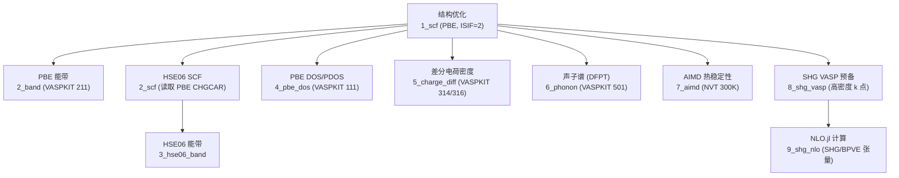

# C2HF — Janus 二维材料第一性原理计算项目

> **研究对象**：二维 Janus 单层材料 C₂HF（碳二氢氟，空间群 P3m1，非中心对称）  
> **核心目标**：系统研究其电子结构、声子谱、热稳定性（AIMD）以及二阶非线性光学响应（SHG/BPVE）

---

## 项目结构

```
C2HF/
├── C2HF/
│   ├── 1_scf/           # PBE 结构优化 + 自洽场计算
│   ├── 2_band/          # PBE 能带结构（VASPKIT 211/212）
│   ├── 2_scf/           # HSE06 预备 SCF（读取 PBE CHGCAR）
│   ├── 3_hse06_band/    # HSE06 杂化泛函能带
│   ├── 4_pbe_dos/       # PBE 态密度（TDOS + PDOS per element）
│   ├── 5_charge_diff/   # 差分电荷密度（成键差分，原子叠加方案）
│   ├── 6_phonon/        # 声子谱（VASP DFPT → VASPKIT 501）
│   ├── 7_aimd/          # AIMD 热稳定性（NVT, 300K, 5 ps）
│   ├── 8_shg_vasp/      # SHG 预备：VASP 高密度 k 点静态计算
│   └── 9_shg_nlo/       # NLO.jl 计算 SHG / BPVE 张量
├── bader-charge/        # Bader 电荷分析脚本与参考文件
├── nlo/                 # NLO 相关脚本与 BPVE/NLO.jl 包
│   └── BPVE/
│       └── NLO.jl/      # Julia 包（独立 git 仓库，不纳入本仓库追踪）
├── software/            # VASPKIT 脚本、POTCAR 生成工具
├── vasp-test/           # 服务器 VASP 环境测试算例
├── .gitignore           # 排除 WAVECAR/CHGCAR/OUTCAR 等大文件
└── DEVIN.md             # 本文件：项目说明与环境配置指南
```

---

## 计算环境配置

### 1. VASP（服务器端）

| 组件 | 版本 / 要求 |
|------|------------|
| VASP | 6.3+ （支持 HSE06、DFPT） |
| MPI  | OpenMPI 4.x 或 IntelMPI |
| 赝势 | PAW-PBE（已存放于 `software/gener_potcar/`） |
| VASPKIT | 1.3.3+（`vaspkit` 需在 `$PATH`） |

```bash
# 检查 VASP 是否可用
which vasp_std
mpirun -np 4 vasp_std  # 在包含 INCAR/POSCAR/KPOINTS/POTCAR 的目录内运行

# 检查 VASPKIT
vaspkit --version
```

### 2. Julia + NLO.jl（非线性光学计算）

```bash
# 安装 Julia 1.9+
julia --version

# 进入 NLO.jl 包目录（嵌套独立仓库）
cd nlo/BPVE/NLO.jl
julia --project=.

# 在 Julia REPL 中安装依赖
] instantiate

# 运行 NLO 计算（以 run_nlo.json5 为配置文件）
cd C2HF/9_shg_nlo
julia --project=../../nlo/BPVE/NLO.jl -e 'using NLOjl; run_nlo("run_nlo.json5")'
# 或使用 slurm 脚本
sbatch shg.slurm
```

### 3. Python 后处理环境

```bash
# 建议使用 conda/mamba
conda create -n c2hf python=3.11
conda activate c2hf
pip install numpy scipy matplotlib pymatgen vasppy

# 差分电荷自动化脚本（见 scripts/ 目录）
python cdd_auto.py           # 交互式拆分 POSCAR + 生成计算文件
python cdd_auto.py --analyze # 自洽完成后一键后处理（VASPKIT 314 + 316）
```

### 4. 可视化工具

- **VESTA 3.x**：加载 `CHGDIFF.vasp` 查看差分电荷密度三维等值面
- **Origin / matplotlib**：绘制能带、DOS、声子谱、SHG 张量频谱

### 5. 科研文献检索与参数核验套件 (PaperQA2 + Stanford STORM)

本项目已集成 FutureHouse PaperQA2（零幻觉学术论文精准问答）与 Stanford STORM（多专家视角调研综述），用于自动对比顶刊文献中的 DFT 计算与非线性光学实验参数：

```bash
# 在 Devin Linux 环境中一键安装文献调研套件
pip install -r requirements_research.txt

# 运行文献调研与参数提取脚本（自动读取 literature_pdf/ 目录下的参考论文）
python research_assistant.py

# 或使用 PaperQA CLI 直接向文献库精准提问
pqa ask "What are the typical SHG chi2 and band gap values for 2D Janus monolayers?"
```

---

## 计算工作流总览



---

## 各步骤关键 INCAR 参数速查

### PBE 结构优化（1_scf）
```fortran
PREC   = Accurate
ENCUT  = 500
EDIFF  = 1E-6
EDIFFG = -0.01
IBRION = 2
NSW    = 100
ISIF   = 2        ! 固定晶格，优化原子位置（2D 材料）
ISMEAR = 0
SIGMA  = 0.05
LCHARG = .TRUE.
LWAVE  = .TRUE.
```

### HSE06 能带（3_hse06_band）
```fortran
LHFCALC = .TRUE.
HFSCREEN = 0.2
ALGO   = All
TIME   = 0.4
PRECFOCK = Fast
AEXX   = 0.25
! 读取 PBE SCF 的 CHGCAR：ICHARG = 11
```

### 差分电荷（5_charge_diff）
```fortran
NSW    = 0
IBRION = -1
LCHARG = .TRUE.
LWAVE  = .FALSE.
ENCUT  = 520       ! 三个体系必须相同，显式指定！
```

### AIMD（7_aimd）
```fortran
IBRION = 0
NSW    = 5000      ! 5 ps（步长 1 fs）
POTIM  = 1.0
TEBEG  = 300
TEEND  = 300
SMASS  = 0
MDALGO = 2         ! Nosé-Hoover 恒温器
```

### SHG VASP 预备（8_shg_vasp）
```fortran
NSW    = 0
LOPTICS = .TRUE.
NEDOS  = 2000
NBANDS = <约 2× 默认值>
ISMEAR = 0
SIGMA  = 0.01
```

---

## Bader 电荷分析

```bash
cd bader-charge/
# 需要先运行 VASP 获得高精度 CHGCAR（LAECHG=.TRUE.）
bader CHGCAR -ref AECCAR0 -ref AECCAR2
# 输出：ACF.dat（每个原子的 Bader 电荷）
```

---

## 注意事项

1. **`nlo/BPVE/NLO.jl/` 是独立 Git 仓库**，已在 `.gitignore` 中排除，请单独 `git clone` 维护。
2. **POTCAR 文件**（`software/gener_potcar/`）已纳入仓库追踪，可直接使用 `vaspkit 103` 或 `gener_potcar.sh` 生成。
3. 大体积 VASP 输出文件（`WAVECAR`、`CHGCAR`、`OUTCAR`、`vasprun.xml` 等）已被 `.gitignore` 排除，**不提交到 Git**。
4. 服务器上运行 VASP 时，请使用对应的 `.slurm` 脚本（见各子目录）。

---

## 联系与参考文献

- 项目负责人：一年级研究生，研究方向：二维非线性光学材料
- 主要软件：VASP 6.x、VASPKIT 1.3.x、NLO.jl、VESTA 3.x
- 关键参考：
  - Perdew, Burke, Ernzerhof, PRL 1996 (PBE)
  - Heyd, Scuseria, Ernzerhof, JCP 2003 (HSE06)
  - NLO.jl: BPVE/SHG 张量计算 Julia 包
